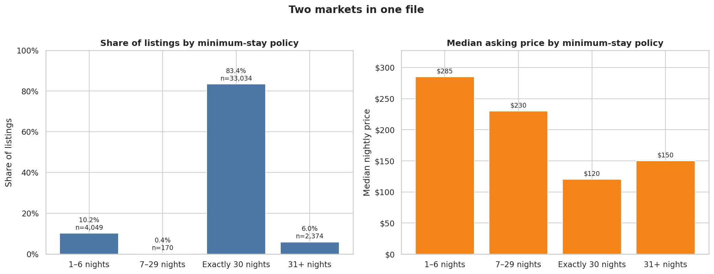
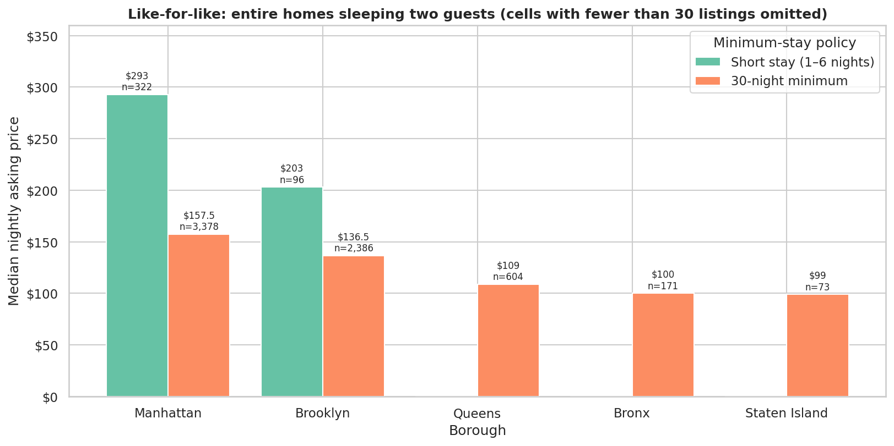
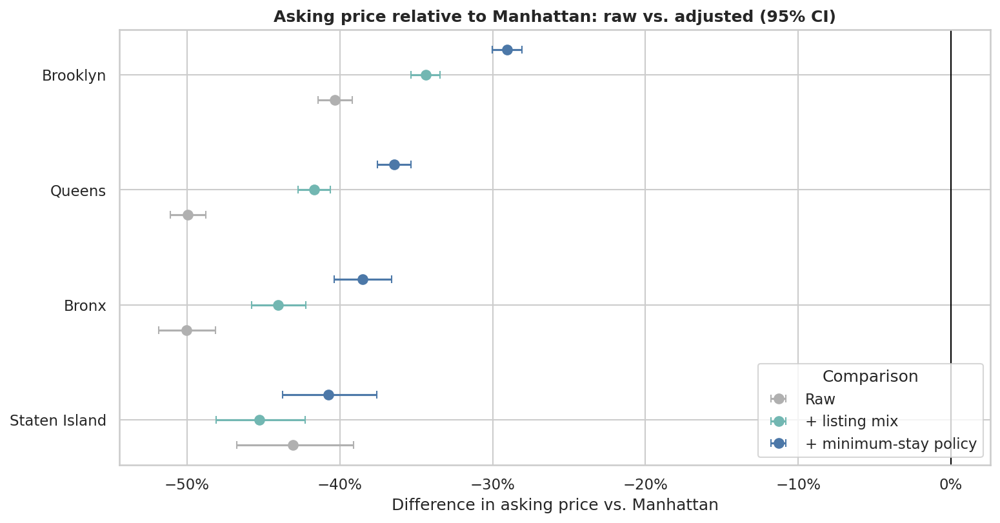
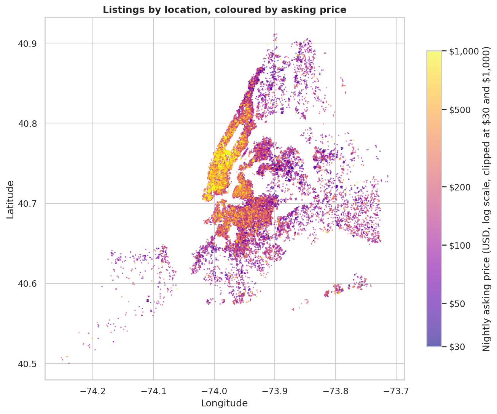

# New York City Airbnb Listings: Price, Space and Minimum-Stay Rules

An exploratory analysis of **39,627 New York City Airbnb listings** that asks how asking prices relate to borough, neighbourhood, room type, capacity, amenities and ratings, and finds that one field, the **minimum-night requirement**, splits the file into two very different markets.

**Python · pandas · NumPy · Matplotlib · seaborn · statsmodels** | Notebook: [`airbnb_listing_market_eda.ipynb`](airbnb_listing_market_eda.ipynb)

## Key findings

1. **The file contains two markets.** 83.4% of listings require exactly 30 nights, while 10.2% accept stays of 1–6 nights. Their median asking prices are \$120 and \$285.
2. **The short-stay premium is large and survives controls.** Holding borough, room type, capacity, bedrooms and amenity count constant, listings accepting 1–6 night stays ask about **90% more** (95% CI 85–95%) than 30-night listings.
3. **Borough gaps shrink but do not vanish.** Relative to Manhattan, Brooklyn is 40.3% lower on a raw basis and 29.1% lower once listing mix and minimum-stay policy are held constant. Queens goes from 50.0% to 36.4% lower and the Bronx from 50.0% to 38.5%.
4. **Room type is the biggest raw difference**: median asking prices are \$176 for entire homes, \$75 for private rooms, \$69 for shared rooms and \$592 for hotel rooms (only 171 listings).
5. **Among entire homes, Tribeca (\$350), SoHo (\$281) and the Theater District (\$272) have the highest neighbourhood medians.**

These are descriptive associations in a single cross-sectional snapshot of **asking prices**, not causal effects and not booking prices.



## Finding 1: two markets in one file

| Minimum-stay policy | Listings | Share | Median asking price |
|---|---:|---:|---:|
| 1–6 nights | 4,049 | 10.2% | \$285 |
| 7–29 nights | 170 | 0.4% | \$230 |
| Exactly 30 nights | 33,034 | 83.4% | \$120 |
| 31+ nights | 2,374 | 6.0% | \$150 |

The gap is not just a location or room-type effect. For **entire homes sleeping two guests**, short-stay listings ask more than 30-night listings in both boroughs with enough data:

| Borough | Short stay (1–6 nights) | 30-night minimum |
|---|---:|---:|
| Manhattan | \$293 (n = 322) | \$157.50 (n = 3,378) |
| Brooklyn | \$203 (n = 96) | \$136.50 (n = 2,386) |

Queens, the Bronx and Staten Island have too few short-stay listings of this kind (13, 14 and 1) to compare.



**Context (a hypothesis, not a finding).** New York City's Local Law 18 has been enforced since 5 September 2023. It requires registration for rentals under 30 days and generally prohibits them unless the host is present, and Airbnb said unregistered listings would be converted to 30-day stays where the host's calendar allowed. A snapshot taken after enforcement would be expected to show a large cluster of 30-night minimums. The file has no snapshot date, so the link cannot be confirmed from the data. The practical point stands either way: an advertised 30-night rate and a short-stay nightly rate should not be treated as the same product.

## Finding 2: how much of the borough gap is real?

A log-price regression compares each borough with Manhattan under three specifications. Percentages are differences in asking price versus Manhattan; standard errors are heteroskedasticity-robust (HC3).

| Borough | Raw | + room type, capacity, bedrooms, amenities | + minimum-stay policy |
|---|---:|---:|---:|
| Brooklyn | −40.3% | −34.4% | −29.1% |
| Queens | −50.0% | −41.7% | −36.4% |
| Bronx | −50.0% | −44.0% | −38.5% |
| Staten Island | −43.1% | −45.3% | −40.7% |

The model uses 36,218 listings (those with a bedroom count) and explains about half the variation in price (R² 0.52). In the full model, 1–6 night listings ask about 90% more than 30-night listings, each extra guest of capacity is associated with about 11% higher prices and each bedroom with about 7%. Re-fitting without the top 1% of prices moves the borough estimates by about two points and the short-stay premium to about 86%, so the results do not depend on extreme prices.



## What else the analysis shows

- **Inventory.** Manhattan (17,367) and Brooklyn (14,453) hold 80.3% of listings, followed by Queens (6,083), the Bronx (1,355) and Staten Island (369). Entire homes are 53.6% of listings and private rooms 44.6%.
- **Neighbourhoods.** Comparing entire homes only (neighbourhoods with at least 50), the highest medians are Tribeca \$350 (n = 156), SoHo \$281 (n = 198), the Theater District \$272 (n = 185), the Financial District \$266 and Midtown \$253.
- **Amenities and ratings.** Within room type, amenity count has a modest positive rank correlation with price (0.17 for entire homes, 0.29 for private rooms) and guest rating a weaker one (about 0.12). Ratings are extracted from listing titles and exist for only 55.0% of listings.
- **Availability.** 35.9% of listings show zero days available over the next year. This is far more common among 30-night listings (39.0%) than 1–6 night listings (19.3%). Availability is a calendar setting, not occupancy.



## Data quality

- 39,627 rows and 20 columns; no duplicate rows or listing IDs. Bedrooms are missing for 3,409 listings, beds for 655 and bathroom text for 37; nothing is imputed.
- The listing title embeds the guest rating (for example `★4.68`), which the analysis extracts. 2,076 listings are marked `★New` and 15,744 show no rating.
- Prices are strongly right-skewed (median \$127, 95th percentile \$579, 99th percentile \$1,388) and contain implausible extremes, up to \$30,000. Five of the seven highest prices are "Room in hotel" listings at roughly \$19,100–\$19,500 per night with a one-night minimum. Records are kept; comparisons use medians and the model is re-run without the top 1% of prices.
- `maximum_nights` contains sentinel values (up to 2,147,483,647) and is not used.

## What the data do not support

- Anything about transactions, occupancy, revenue or demand: prices are asking prices and availability is a calendar setting.
- Causal claims, such as "a short-stay policy raises price" or "Brooklyn is cheaper because of its location".
- Conclusions about thin groups: 7–29 night listings, Staten Island and Bronx short-stay listings, and hotel rooms.

## Limitations

- Single cross-sectional snapshot with no date, so no trends. The source, snapshot date and licence are not stated in the file.
- Ratings are a self-selected subset; amenities are counted equally; the regression excludes listings with missing bedrooms and does not model neighbourhood, exact location or property quality.

## Possible next step

Extend the regression to include neighbourhood and distance to the city centre, evaluate it on held-out neighbourhoods, and, if a dated listing history or transaction data become available, study price trends and booking demand directly.


```
├── airbnb_listing_market_eda.ipynb   # full analysis with saved outputs
├── images/                           # charts used in this README
├── data/                             # put airbnb.csv here (not committed)
├── requirements.txt
└── README.md
```
